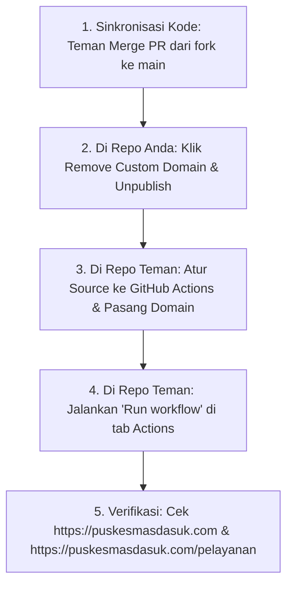

# Migrasi Hosting & Custom Domain ke Upstream Implementation Plan

> **Goal:** Memindahkan hosting GitHub Pages dan custom domain `puskesmasdasuk.com` dari repositori fork (`Rahdansuwa24/PKM-DASUK`) ke repositori asal/utama milik teman (`LexyMangkuNEGORO25/PKM-DASUK`) secara aman tanpa downtime atau konflik domain.

---

### Ringkasan Alur Kerja



---

## Rincian Tugas Langkah demi Langkah

### Task 1: Sinkronisasi Kode ke Repositori Teman (Upstream)
**Tujuan:** Memastikan repo asal teman sudah memiliki seluruh konfigurasi build dan SEO terbaru sebelum domain dipasang.

- [ ] **Step 1:** Cek status Pull Request dari branch `Rahdansuwa24:main` ke `LexyMangkuNEGORO25:main`.
- [ ] **Step 2:** Pastikan file-file berikut ikut ter-merge di branch `main` repo teman:
  - `.github/workflows/deploy.yml` (Otomatisasi build Vite)
  - `vite.config.js` (`base: '/'` dan plugin copy `404.html`)
  - `public/CNAME` (`puskesmasdasuk.com`)
  - `public/favicon*` (`favicon.ico`, `favicon-48x48.png`, `favicon-192x192.png`, dll.)
  - `public/robots.txt` & `public/sitemap.xml`
- [ ] **Step 3:** Teman melakukan **Merge Pull Request** ke branch `main`.

---

### Task 2: Pelepasan Domain di Repositori Anda (`Rahdansuwa24/PKM-DASUK`)
**Tujuan:** Membebaskan klaim nama domain `puskesmasdasuk.com` di GitHub agar tidak ditolak saat didaftarkan di repo teman.

- [ ] **Step 1:** Buka `https://github.com/Rahdansuwa24/PKM-DASUK/settings/pages`.
- [ ] **Step 2:** Pada kolom **Custom domain**, klik tombol merah **`Remove`**.
- [ ] **Step 3:** Pada bagian atas (*Your site is live at...*), klik tombol **`Unpublish site`**.
- [ ] **Step 4:** Konfirmasi pelepasan domain berhasil (kolom Custom domain kini kosong).

---

### Task 3: Aktivasi & Pemasangan Domain di Repositori Teman (`LexyMangkuNEGORO25/PKM-DASUK`)
**Tujuan:** Mengalihkan hak hosting domain resmi ke repo teman.

- [ ] **Step 1:** Minta teman membuka `https://github.com/LexyMangkuNEGORO25/PKM-DASUK/settings/pages`.
- [ ] **Step 2:** Di bagian **Build and deployment** > **Source**, pilih **GitHub Actions**.
- [ ] **Step 3:** Di bagian **Custom domain**, ketik:
  ```text
  puskesmasdasuk.com
  ```
  lalu klik **Save**.
- [ ] **Step 4:** Tunggu verifikasi DNS selesai (titik berubah menjadi centang hijau), lalu aktifkan centang **Enforce HTTPS**.

---

### Task 4: Eksekusi Deployment Pertama di Repositori Teman
**Tujuan:** Menjalankan build Vite perdana di repo teman.

- [ ] **Step 1:** Teman membuka tab **Actions** di `https://github.com/LexyMangkuNEGORO25/PKM-DASUK/actions`.
- [ ] **Step 2:** Klik workflow **Deploy to GitHub Pages** di sebelah kiri.
- [ ] **Step 3:** Klik menu **Run workflow** > pilih branch `main` > klik tombol hijau **Run workflow**.
- [ ] **Step 4:** Pantau hingga kedua job (`build` dan `deploy`) selesai berstatus **Success** (centang hijau).

---

### Task 5: Verifikasi Live & Google Search Console
**Tujuan:** Memastikan website tetap beroperasi normal tanpa kendala.

- [ ] **Step 1:** Buka `https://puskesmasdasuk.com/` di peramban (pastikan halaman beranda tampil normal).
- [ ] **Step 2:** Buka langsung rute `https://puskesmasdasuk.com/pelayanan` (pastikan tidak 404).
- [ ] **Step 3:** Di **Google Search Console**, Anda **TIDAK PERLU** mengubah konfigurasi apa pun karena verifikasi GSC terikat pada nama domain `puskesmasdasuk.com`, bukan pada username GitHub Anda.
